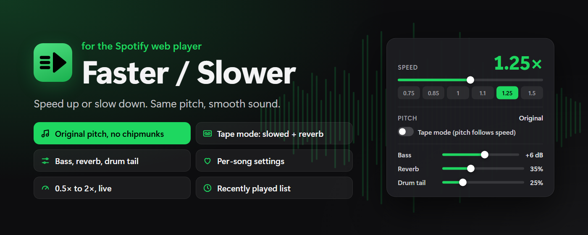
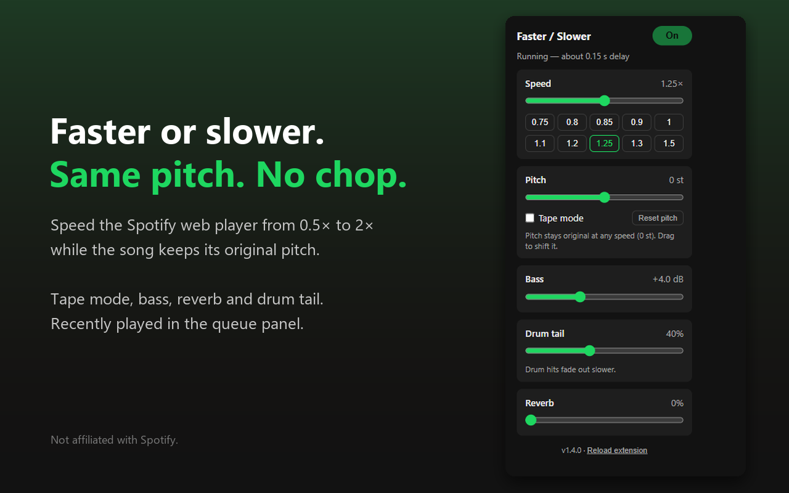
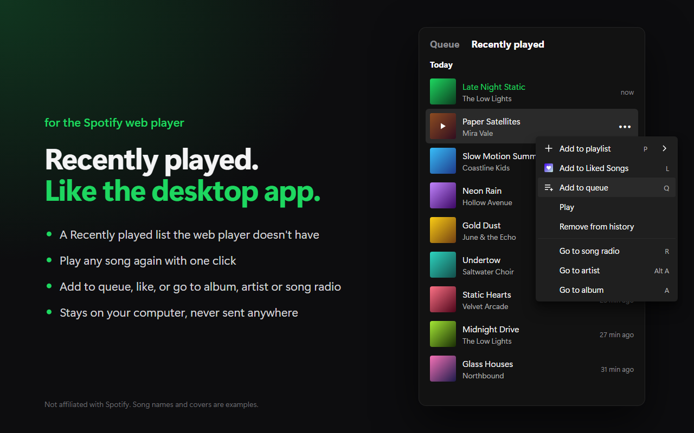
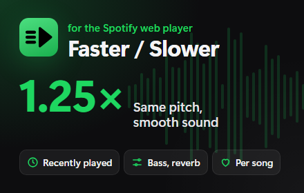

# Spotify Faster / Slower Control

(Formerly "Spotify Stretch". Not affiliated with or endorsed by Spotify.)

Chrome extension that plays the Spotify web player faster or slower **at the original pitch** — the "sped-up edit" feel without the chipmunk voice and without the choppy sound of Chrome's own pitch keeping. Adds a bass boost and optional reverb.

How it works: the song is sped up with plain resampling (smooth, pitch goes up), the tab's sound is captured, and a music-grade pitch shifter (Signalsmith Stretch) brings the pitch back down by exactly the amount the speed raised it. Expect about 0.15 s of delay.

A YouTube version with the same sound engine, plus a picture delay that keeps lips in sync, lives in its own repository: [youtube-faster-slower-playback-speed](https://github.com/citrunade/youtube-faster-slower-playback-speed).

## Screenshots

| Faster or slower, same pitch | Recently played |
|---|---|
|  |  |

Small promo tile: 

## Install

1. Turn off any other Spotify speed extension (they fight over the speed).
2. Open `chrome://extensions`, switch on **Developer mode** (top right).
3. Click **Load unpacked** and pick this folder (`C:\SpotifyStretch`).
4. Reload any Spotify tab that was already open.

## Use

1. Open https://open.spotify.com and play something.
2. Click the extension icon (or press **Alt+Shift+S**) to turn it on — on any page; it is one switch for all of Chrome and stays on through refreshes, other tabs and restarts until you click it again. The **OFF** mark on the icon disappears, and a speed button appears in Spotify's player bar next to Queue; click it for the settings. The tab you clicked in gets the full sound engine; other Spotify tabs (and tabs opened later) play at your speed in **light mode** (Chrome's own pitch keeping, no effects), because Chrome only allows capturing a tab's sound after a click in that tab. To upgrade one, click the icon once in it, press Alt+Shift+S, or right-click the page and choose **Faster / Slower: smooth sound in this tab**. A light tab shows a small amber dot on the speed button, a one-time tip, and an explanation in the settings panel (with a link to change the shortcut).
3. Pick a speed: 0.5–2× (presets 0.75–0.9 slowed, 1.1–1.5 sped up), plus bass and reverb. Changes apply live and are remembered.
4. **Pitch**: the slider shows how the song sounds compared with the original (0 st = original). With tape mode off it stays at 0 at any speed; drag to shift higher or lower. **Reset pitch** removes your own shift. **Tape mode** lets pitch follow speed (slowed sounds deeper, sped up sounds higher, the classic "slowed + reverb" / nightcore); the pitch slider is then greyed out and just shows the result (e.g. +3.9 st at 1.25×).
5. **Drum tail** makes drum hits fade out slower (drum frequency ranges only). Starts at 0. A limiter at the end keeps stacked effects from distorting.
6. **This song**: the panel's second tab. While its switch is on (it stays on from song to song), each song keeps its own speed, pitch, tape mode, bass, drum tail and reverb: change anything there and it is saved for the song playing ("Saved" pops up) and used every time it plays. Songs never changed play with the usual settings; a dot on the tab shows when the current song has its own. **Use usual** forgets one song's settings. Switch it off and every song uses the **Usual** tab again (saved songs are kept for when it is switched back on).
7. Click the icon (or Alt+Shift+S) again to go back to normal Spotify; the speed button disappears.

### Recently played

The web player has no track history, so the extension keeps one: every song that plays for a few seconds is added (last 200). Open it from the **Recently played** tab added next to **Queue** in Spotify's queue panel. Double-click a song, or hover and click the play button on its cover, to play it; you stay on the page you were on. Right-click it (or hover and click **⋯**) for the desktop-style menu: Add to queue, Add to Liked Songs, Go to song radio, Go to album, Go to artist, Remove from history. These work through Spotify's own song menu on the song's album page, opened out of sight, so they rely on Spotify's English menu labels. Only songs played in the web player after installing are recorded.

While it is on, Chrome shows a "sharing this tab's audio" indicator — that is the capture. It needs to be switched on again after closing the tab or restarting Chrome.

## App window (starts by itself)

A separate window that looks like the Spotify app (no tabs, no address bar) and switches the extension on by itself, with no icon click. It uses its own Chrome profile, so you sign in to Spotify there once.

Normal Chrome only lets an extension capture a tab after you click it. The shortcut starts this profile with a Chrome switch that lifts that rule for this one extension only.

One-time setup:
1. Run `powershell -ExecutionPolicy Bypass -File setup-app-window.ps1`. It creates the **Spotify Stretch** shortcut (Desktop and Start menu) and a **Spotify Stretch - setup** shortcut.
2. Open **Spotify Stretch - setup**, go to `chrome://extensions`, turn on **Developer mode**, **Load unpacked** → `C:\SpotifyStretch`. Close that window.
3. Open **Spotify Stretch**, sign in to Spotify. To pin it, right-click the Start menu entry → Pin to taskbar.

In the player bar (next to the queue and volume buttons) there is a speed button, e.g. **1.25×**: green when on. Click it for the settings. Turning it **Off** there is remembered; turn it **On** again to resume auto-start.

The extension ID is tied to the folder path: if you move the folder, re-run the setup script with the new ID.

## Files

| File | Role |
|---|---|
| `page-rate.js` | Runs inside Spotify; forces the speed with pitch keeping off |
| `content.js` | Passes the speed from the extension to the page; speed button in the player bar |
| `history.js`, `history-render.js` | Recently played: records songs, queue-panel tab, play from history |
| `service-worker.js` | Starts/stops capture, keeps speed and pitch shift in step |
| `drum-tail-worklet.js` | Drum tail effect (longer decay after each hit) |
| `offscreen.*`, `audio-chain.js` | Captured audio → pitch shift → bass → reverb → speakers |
| `popup.*` | Settings panel, opened from the speed button in Spotify's player bar |
| `setup-app-window.ps1` | Creates the app-window shortcuts |
| `lib/SignalsmithStretch.mjs` | Signalsmith Stretch 1.3.2 (MIT, © Geraint Luff / Signalsmith Audio), from npm `signalsmith-stretch` |
| `icons/` | Extension icons |
| `store/` | Chrome Web Store listing text and privacy policy |
| `build-store.ps1` | Builds the zip to upload to the Chrome Web Store (`dist/`) |
| `tests/test.html` | Self-test: serve the folder with `python -m http.server` and open `/tests/test.html` |
